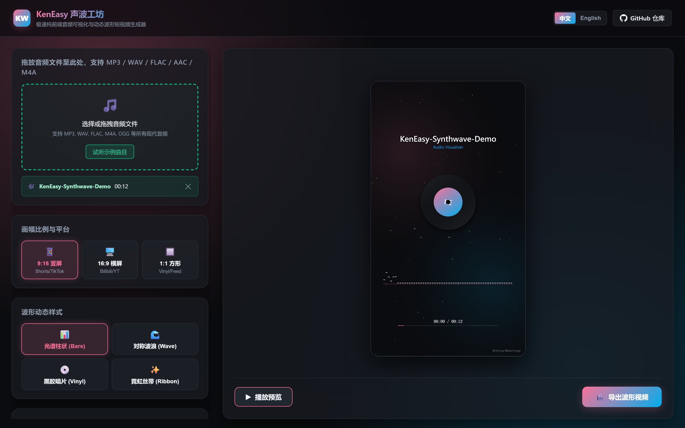
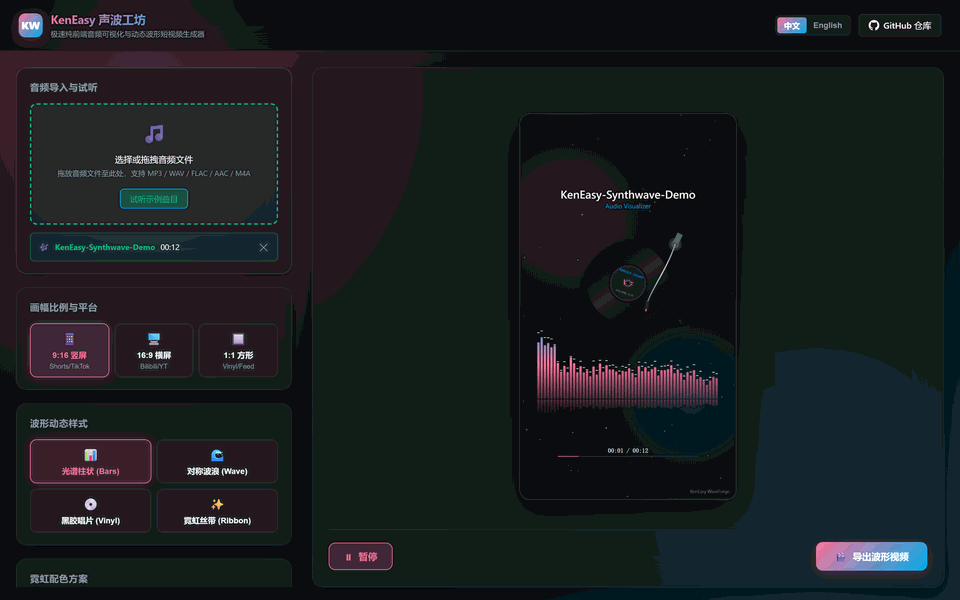
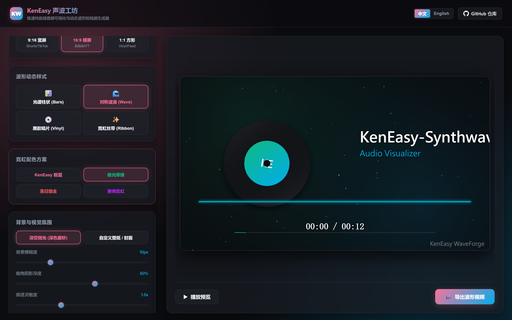
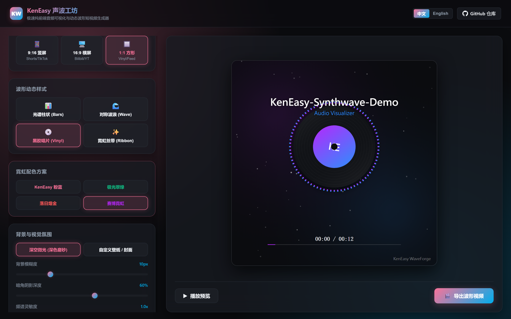
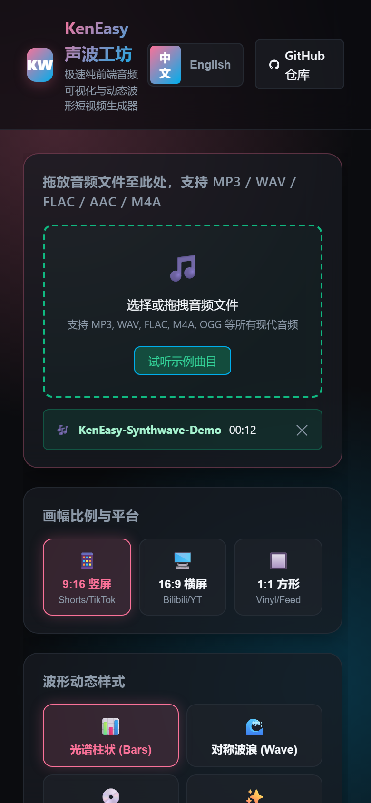

<div align="center">

# KenEasy WaveForge

**Pure Client-Side Audio Visualizer & Video Generator** — Drop audio, pick 9:16 / 16:9 / 1:1 aspect ratios and dynamic wave styles, then export crisp videos in seconds.
Everything runs locally in your browser: **no upload, no waitlist, no paywall, and zero privacy leakage**.

<br/>

### 👉 Try Online Now

# [🚀 Open WaveForge (Web App)](https://ngiken.github.io/KenEasy-WaveForge/)

**https://ngiken.github.io/KenEasy-WaveForge/**

> 💡 The link above is the **live web application**.
> Comes with a built-in **"✨ Play Demo Track"** button to try audio-visual sync immediately with zero files prepared!

<br/>

[中文](README.md) · [English](README.en.md)

<br/>


<br/><br/>



<sub>KenEasy Signature Dark-Glass Aesthetics · 60FPS Pure Canvas + Web Audio Engine</sub>

</div>

---

## 30-Second Quickstart

1. Open: **[Live Web App](https://ngiken.github.io/KenEasy-WaveForge/)**
2. Drop your audio file (MP3, WAV, FLAC, M4A, OGG), or click **"✨ Play Demo Track"** to synthesize a built-in rhythmic Lo-Fi groove.
3. Choose your canvas aspect ratio:
   - 📱 **9:16 Portrait**: TikTok / Shorts / Reels / Xiaohongshu
   - 🖥️ **16:9 Landscape**: YouTube / Bilibili / Desktop presentations
   - 🔲 **1:1 Square**: Vinyl covers / Instagram / Social feeds
4. Pick your favorite **Wave Style** (Spectrum Bars, Mirrored Wave, Vinyl Radial, Neon Ribbon) and **Color Theme**.
5. (Optional) Drag handles on the timeline waveform to trim the best hook/climax section.
6. Click **"🎬 Export Wave Video"** → Hardware-accelerated local rendering produces an instant MP4/WebM download!

### Animated Quick Tour

<p align="center">
  
</p>

<p align="center"><strong>① Load Audio　→　② Customize Styles　→　③ Export Crisp Video</strong></p>

---

## Key Highlights

| User Pain Point | WaveForge Solution |
|---|---|
| **Audio cannot be posted directly on video-first platforms** | Turns pure audio into visually striking videos ready for social media |
| **Heavy video editors (Premiere/After Effects) are too cumbersome** | Runs in browser tabs with instant real-time WYSIWYG feedback |
| **Online visualizer sites enforce watermarks and subscription fees** | 100% free and open-source with no limitations or hidden fees |
| **Confidential voice notes / original songs leaked to cloud servers** | Client-side only with Web Audio API & MediaRecorder; files never leave your tab |
| **No audio file at hand for testing** | Procedural Web Audio synthesizer generates instant live tracks with one click |

---

## Visual Styles & Platform Formats

### 🖥️ 16:9 Landscape Mode (for YouTube / Bilibili)
<p align="center">
  
</p>

### 💿 1:1 Vinyl Radial Mode (for Social Feeds & Vinyl Covers)
<p align="center">
  
</p>

### 📱 Adaptive Mobile Layout
<p align="center">
  
</p>

---

## 4 Algorithmic Waveform Modes

1. **📊 Spectrum Bars**: Classic graphic equalizer bars with peak-drop gravity physics and reflections.
2. **🌊 Mirrored Wave**: Symmetric glowing pulse curves with organic fluid breathing motion.
3. **💿 Vinyl Radial**: Rotating photorealistic vinyl turntable with radiating audio particle ring.
4. **✨ Neon Ribbon**: Multi-layered interwoven Bezier ribbons reminiscent of glowing auroras.

---

## Local Development & Testing

```powershell
# 1. Start local development server
python -m http.server 8080 --directory web
# Open http://localhost:8080 in your browser

# 2. Run E2E test suite
cd scratch/e2e
node run.mjs

# 3. Capture screenshots and rebuild animated GIF
node capture-readme.mjs
python build-readme-gif.py
```

---

## License

Released under the [MIT License](./LICENSE). Stars, forks, and contributions are warmly welcome!
